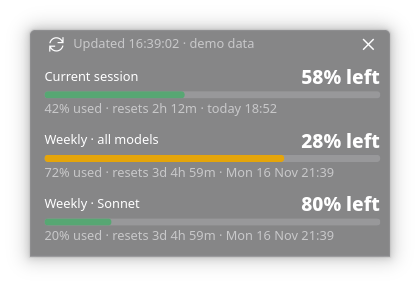

# Claude Usage Monitor

> **Linux only, and unofficial.** Not affiliated with or endorsed by Anthropic. It reads the same usage numbers Claude Code shows in `/usage`, from an **undocumented** endpoint that Anthropic can change or remove at any time.

A small, **semi-transparent desktop widget** that shows how much of your Claude subscription limits you have left, and when each one resets. It lives in the system tray, warns you before you run out, and can start with your session.


*Screenshot taken with `--demo` (fake data).*

## Features

| | |
|---|---|
| **Current session (5 h)** | % left, % used, live countdown and local reset time |
| **Weekly, all models** | same, for the weekly limit across every model |
| **Weekly, Sonnet / Opus** | shown only if your plan reports separate limits for them |
| **Tray icon** | a ring that shrinks as the session runs down, with the % left in the middle. Colour changes at 70 % and 90 % used. Tooltip lists every limit |
| **Alerts** | one desktop notification per window when a limit reaches 90 % used |
| **Auto refresh** | every 90 seconds; countdowns tick every second |
| **Small + transparent** | about 300 × 135 px, 55 % opaque. Drag anywhere to move it |
| **Tray menu** | right-click: show/hide, refresh now, quit. Closing the window hides it to the tray |


## Requirements

- Linux with Python 3.10+
- GTK 4, libadwaita and the Python bindings (PyGObject, pycairo)
- `notify-send` (libnotify) for alerts
- A desktop with a StatusNotifier tray (KDE Plasma works out of the box; GNOME needs the AppIndicator extension). Without a tray the app still works as a normal window.
- You must be logged in to **Claude Code** (`claude`) with a Pro/Max subscription: the monitor reuses its login.

Install the dependencies:

```bash
# Fedora
sudo dnf install python3-gobject python3-cairo gtk4 libadwaita libnotify
# Debian / Ubuntu
sudo apt install python3-gi python3-gi-cairo gir1.2-gtk-4.0 gir1.2-adw-1 libnotify-bin
```

## Install

```bash
git clone https://github.com/kranmal/claude-usage-monitor
cd claude-usage-monitor
./install.sh --autostart      # drop --autostart if you don't want it at login
claude-usage-monitor
```

`--autostart` starts it hidden in the tray at login; click the tray icon to open the window. Remove everything with `./install.sh --uninstall`.

To just try it without installing: `python3 claude_usage.py` (or `--demo` for fake data).

## Options

| Flag | Effect |
|------|--------|
| `--demo` | fake data, no network, no credentials read |
| `--hidden` | start in the tray without opening the window (falls back to showing it if there is no tray) |

Polling interval, alert threshold and transparency are constants at the top of the script. See [docs/CONFIGURATION.md](docs/CONFIGURATION.md).

## Privacy and security

- It reads your Claude Code OAuth access token from `~/.claude/.credentials.json` and sends it **only** to `https://api.anthropic.com/api/oauth/usage`, which is where Claude Code itself reports usage.
- It never writes or refreshes that file, so it can't log Claude Code out. If the token has expired it tells you to run `claude` once.
- No telemetry, no other network calls, nothing is stored.

Details in [docs/HOW_IT_WORKS.md](docs/HOW_IT_WORKS.md). Problems? See [docs/TROUBLESHOOTING.md](docs/TROUBLESHOOTING.md).

## Tests

```bash
python3 -m unittest discover tests
```

## Licence

MIT. See [LICENSE](LICENSE).
